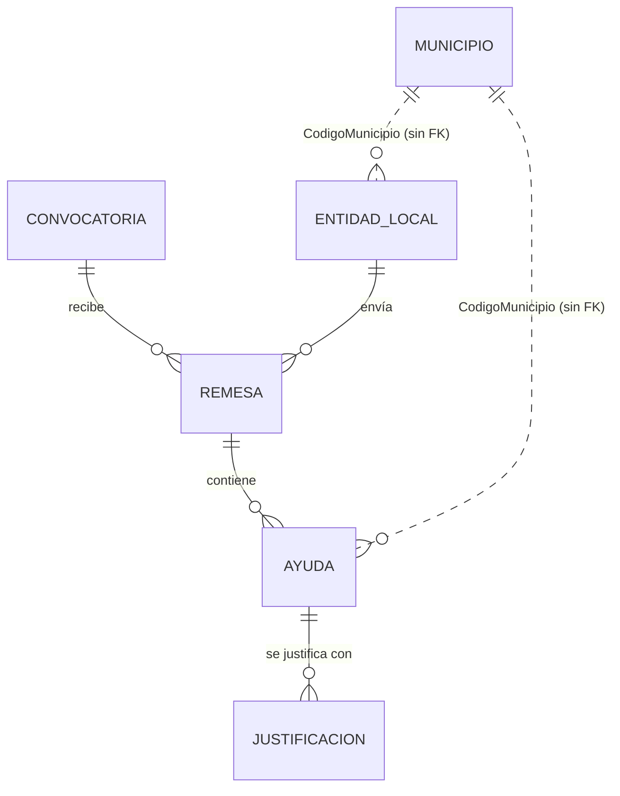
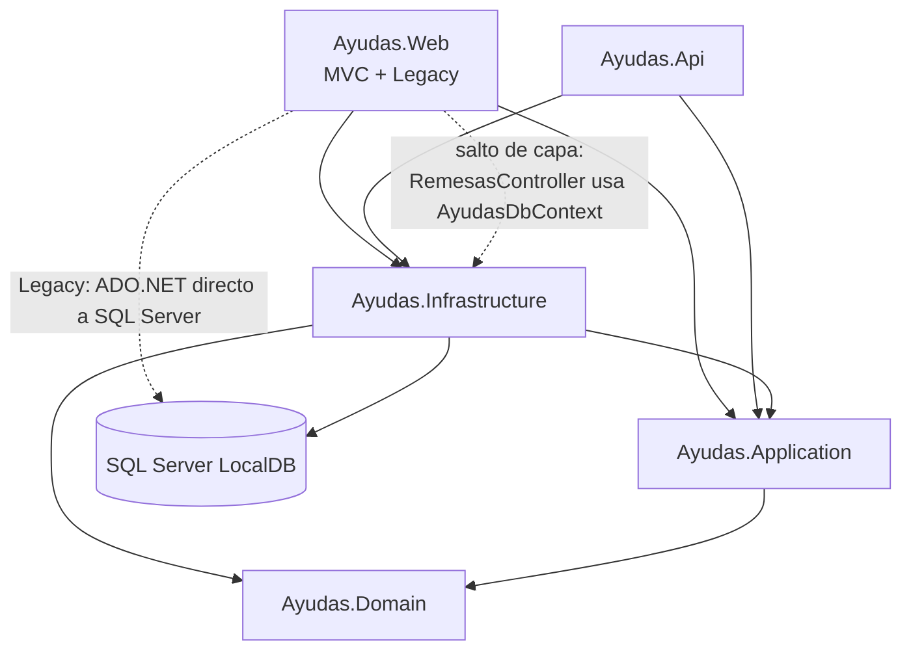
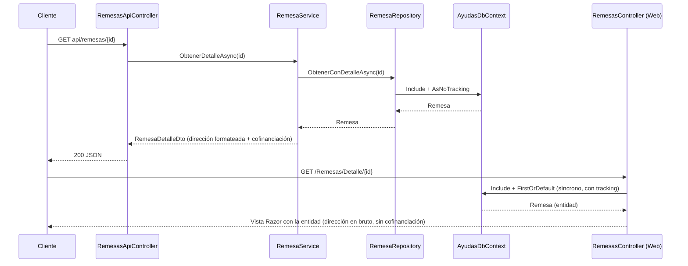

# Arquitectura de la solución `Ayudas`

> Análisis técnico del código, la estructura y la arquitectura del repositorio.
> Fecha del análisis: 19/10/2026 · Rama: `main` (incluye cambios sin commit del working tree).
> Todas las rutas son relativas a la raíz del repositorio.

---

## 1. Resumen ejecutivo

**Propósito.** Aplicación de formación (curso «Claude Code para .NET») que gestiona las **remesas de solicitudes de ayuda** que las **entidades locales** envían para cada **convocatoria**. Los datos son ficticios ([README.md](../README.md)).

**Stack.**

| Aspecto | Tecnología |
|---|---|
| Runtime / lenguaje | .NET 8 (`net8.0`), C# 12, `Nullable` e `ImplicitUsings` activados ([Directory.Build.props](../Directory.Build.props)) |
| Front | ASP.NET Core MVC + Razor (`Ayudas.Web`) |
| API | ASP.NET Core Web API (`Ayudas.Api`) |
| Persistencia | EF Core 8 + SQL Server LocalDB; ADO.NET puro en el módulo heredado |
| Esquema | `EnsureCreated` + datos semilla, **sin migraciones** |
| Pruebas | xUnit 2.9.2, fakes manuales, SQLite en memoria para integración |

**Valoración global.** La solución sigue una **Clean Architecture por capas** razonablemente bien planteada (Domain → Application → Infrastructure, con las interfaces de repositorio en Application e inyección de dependencias por capa). El núcleo nuevo (Entidades, Ayudas, Informes, API) es correcto y legible. Los problemas se concentran en **puntos concretos que rompen las capas** (Remesas en la Web, módulo `Legacy`), en un **dominio anémico** y en **ausencia de seguridad**.

**Top 5 riesgos.**

1. **Sin autenticación ni autorización** en Web y Api: cualquiera puede editar entidades o validar justificaciones ([src/Ayudas.Web/Program.cs:47](../src/Ayudas.Web/Program.cs#L47)).
2. **`RemesasController` accede al `DbContext` directamente** y pagina en memoria cargando todas las remesas ([src/Ayudas.Web/Controllers/RemesasController.cs:20-24](../src/Ayudas.Web/Controllers/RemesasController.cs#L20-L24)).
3. **Módulo `Legacy/Justificaciones`**: ADO.NET estático en la capa Web, SQL concatenado y regla de negocio en el controlador ([JustificacionesDAL.cs:46](../src/Ayudas.Web/Legacy/Justificaciones/JustificacionesDAL.cs#L46), [JustificacionesController.cs:46-59](../src/Ayudas.Web/Legacy/Justificaciones/JustificacionesController.cs#L46-L59)).
4. **Errores silenciados** (`catch { }`, `Console.WriteLine`) que muestran pantallas vacías en lugar de fallar ([InformesController.cs:23-25](../src/Ayudas.Web/Controllers/InformesController.cs#L23-L25)).
5. **Sin migraciones**: cualquier cambio de esquema exige borrar la base de datos ([InicializadorBd.cs](../src/Ayudas.Infrastructure/Persistencia/InicializadorBd.cs)).

---

## 2. Dominio funcional

| Concepto | Descripción | Fichero |
|---|---|---|
| Convocatoria | Línea de ayudas de un ejercicio, con % de cofinanciación estatal (0,80 = 80 %) y fechas `DateOnly` | [Convocatoria.cs](../src/Ayudas.Domain/Entidades/Convocatoria.cs) |
| EntidadLocal | Ayuntamiento, diputación, comarca o mancomunidad que envía remesas | [EntidadLocal.cs](../src/Ayudas.Domain/Entidades/EntidadLocal.cs) |
| Remesa | Envío de una entidad para una convocatoria; tiene un `EstadoRemesa` | [Remesa.cs](../src/Ayudas.Domain/Entidades/Remesa.cs) |
| Ayuda | Línea de la remesa: beneficiario, importes solicitado y concedido | [Ayuda.cs](../src/Ayudas.Domain/Entidades/Ayuda.cs) |
| Justificacion | Justificación del gasto de una ayuda; estado como texto `P/A/R` | [Justificacion.cs](../src/Ayudas.Domain/Entidades/Justificacion.cs) |
| Municipio | Catálogo con clave en el código INE (5 dígitos) | [Municipio.cs](../src/Ayudas.Domain/Entidades/Municipio.cs) |

Enumerados: `EstadoRemesa` (Recibida=1, EnValidacion=2, Validada=3, Rechazada=4, Pagada=5) en [EstadoRemesa.cs](../src/Ayudas.Domain/Entidades/EstadoRemesa.cs) y `TipoEntidad` (Ayuntamiento=1, Diputacion=2, Comarca=3, Mancomunidad=4) en [TipoEntidad.cs](../src/Ayudas.Domain/Entidades/TipoEntidad.cs).

---

## 3. Estructura de la solución

[Ayudas.sln](../Ayudas.sln) agrupa los proyectos en dos carpetas de solución (`src` y `tests`).

| Proyecto | SDK | NuGet | Referencias |
|---|---|---|---|
| [Ayudas.Domain](../src/Ayudas.Domain) | `Microsoft.NET.Sdk` | — | — |
| [Ayudas.Application](../src/Ayudas.Application) | `Microsoft.NET.Sdk` | `Microsoft.Extensions.DependencyInjection.Abstractions` 8.0.2 | Domain |
| [Ayudas.Infrastructure](../src/Ayudas.Infrastructure) | `Microsoft.NET.Sdk` | `Microsoft.EntityFrameworkCore.SqlServer` 8.0.11 | Application, Domain |
| [Ayudas.Web](../src/Ayudas.Web) | `Microsoft.NET.Sdk.Web` | — (SqlClient transitivo) | Application, Infrastructure |
| [Ayudas.Api](../src/Ayudas.Api) | `Microsoft.NET.Sdk.Web` | — | Application, Infrastructure |
| [Ayudas.Tests.Unit](../tests/Ayudas.Tests.Unit) | `Microsoft.NET.Sdk` | xUnit 2.9.2, Test.Sdk 17.11.1 | Application, Domain |
| [Ayudas.Tests.Integration](../tests/Ayudas.Tests.Integration) | `Microsoft.NET.Sdk` | xUnit, `Microsoft.EntityFrameworkCore.Sqlite` 8.0.11 | Infrastructure |

**Ficheros transversales**

- [Directory.Build.props](../Directory.Build.props): `net8.0`, C# 12, `Nullable`, `ImplicitUsings`, `TreatWarningsAsErrors=false`.
- [.editorconfig](../.editorconfig): namespaces con ámbito de fichero, campos privados `_camelCase`, sangría 4/2 espacios.
- [scripts/](../scripts): `reset-bd.ps1` (recrea la BD), `empezar-sesion.ps1` (cambia a la rama de la sesión, resetea y compila), `guardar-trabajo.ps1` (commit en `mi-trabajo-sN`).

---

## 4. Arquitectura por capas

### 4.1 Domain — `src/Ayudas.Domain`

- Sin dependencias externas (correcto para el núcleo).
- **Modelo anémico**: todas las entidades son POCOs con `set` público, sin constructores, invariantes ni transiciones de estado controladas (p. ej. `Remesa.Estado` se puede asignar libremente: [Remesa.cs](../src/Ayudas.Domain/Entidades/Remesa.cs)).
- [Comun/Nif.cs](../src/Ayudas.Domain/Comun/Nif.cs): validación de DNI, NIE y NIF de organización (`EsValido`, `LetraDni`, `ControlOrganizacion`). Es un helper estático, no un *value object*.
- El estado de la justificación es un `string` (`"P"`, `"A"`, `"R"`) en lugar de enum ([Justificacion.cs:19](../src/Ayudas.Domain/Entidades/Justificacion.cs#L19)).

### 4.2 Application — `src/Ayudas.Application`

| Elemento | Ficheros | Notas |
|---|---|---|
| Registro DI | [DependencyInjection.cs](../src/Ayudas.Application/DependencyInjection.cs) | `AddAplicacion()`: 5 servicios *Scoped* |
| Puertos (repositorios) | [Abstracciones/](../src/Ayudas.Application/Abstracciones) | `IEntidadRepository`, `IRemesaRepository`, `IAyudaRepository`, `IInformeRepository`, `IMunicipioRepository` |
| Servicios | [Servicios/](../src/Ayudas.Application/Servicios) | `EntidadService`, `RemesaService`, `AyudaService`, `InformeService`, `CatalogoService` + interfaces |
| DTOs | [Dtos/](../src/Ayudas.Application/Dtos) | `EntidadListadoDto`, `EntidadEdicionDto`, `RemesaDetalleDto`, `AyudaListadoDto`, `InformeResumenDto`, `PaginaResultado<T>`… |
| Excepciones | [Excepciones/](../src/Ayudas.Application/Excepciones) | `ValidacionException(campo, mensaje)`, `EntidadNoEncontradaException(id)` |

Aspectos destacables:

- [EntidadService.cs](../src/Ayudas.Application/Servicios/EntidadService.cs): limpia y valida el NIF (línea 64), comprueba unicidad y que el código INE tenga 5 dígitos (línea 75). Mapeo manual entidad ↔ DTO.
- [RemesaService.cs](../src/Ayudas.Application/Servicios/RemesaService.cs): construye `RemesaDetalleDto` y calcula la cofinanciación redondeando cada línea a céntimos (líneas 59-70). La normalización de la dirección está en `FormatearDireccion` (líneas 72-82).
- [AyudaService.cs:8](../src/Ayudas.Application/Servicios/AyudaService.cs#L8): `TamanoPagina = 20`.
- No se usa FluentValidation, AutoMapper ni MediatR: el enfoque es deliberadamente simple.

### 4.3 Infrastructure — `src/Ayudas.Infrastructure`

- [DependencyInjection.cs](../src/Ayudas.Infrastructure/DependencyInjection.cs): `AddInfraestructura(cadena)` registra `AuditoriaInterceptor` (*Singleton*), `AyudasDbContext` con `UseSqlServer` y los 5 repositorios (*Scoped*).
- [Persistencia/AyudasDbContext.cs](../src/Ayudas.Infrastructure/Persistencia/AyudasDbContext.cs): 6 `DbSet` y `ApplyConfigurationsFromAssembly`.
- [Persistencia/Configuraciones/](../src/Ayudas.Infrastructure/Persistencia/Configuraciones): Fluent API. Índices únicos en `Nif`, `Codigo` y `Referencia`; `decimal(12,2)` en importes y `(5,4)` en el porcentaje; cascada Remesa → Ayuda → Justificación; `Restrict` hacia Entidad y Convocatoria. La tabla heredada se mapea como `JUSTIFICACIONES` con columnas en mayúsculas ([JustificacionConfiguration.cs:14](../src/Ayudas.Infrastructure/Persistencia/Configuraciones/JustificacionConfiguration.cs#L14)).
- [Persistencia/AuditoriaInterceptor.cs](../src/Ayudas.Infrastructure/Persistencia/AuditoriaInterceptor.cs): rellena `FechaModificacion` y `UsuarioModificacion` en las `EntidadLocal` modificadas (líneas 38-39).
- [Persistencia/InicializadorBd.cs](../src/Ayudas.Infrastructure/Persistencia/InicializadorBd.cs): `EnsureDeleted` opcional + `EnsureCreated` + semilla si no hay municipios.
- [Persistencia/DatosSemilla.cs](../src/Ayudas.Infrastructure/Persistencia/DatosSemilla.cs): semilla determinista (`new Random(2026)`): 20 municipios, 3 convocatorias, 12 entidades, 45 remesas. Las entidades 6 y 10 no tienen dirección de notificación (línea 117).
- [Repositorios/](../src/Ayudas.Infrastructure/Repositorios): `RemesaRepository` usa `Include` + `AsNoTracking`; `AyudaRepository` pagina en BD con proyección a DTO; `InformeRepository` agrega datos y lee justificaciones pendientes.

### 4.4 Presentación MVC — `src/Ayudas.Web`

| Controlador | Dependencia | Observación |
|---|---|---|
| [HomeController](../src/Ayudas.Web/Controllers/HomeController.cs) | — | Portada y error |
| [EntidadesController](../src/Ayudas.Web/Controllers/EntidadesController.cs) | `IEntidadService`, `ILogger` | El más correcto: async, antiforgery, excepciones tipadas, logging |
| [RemesasController](../src/Ayudas.Web/Controllers/RemesasController.cs) | **`AyudasDbContext`** | Se salta Application; síncrono; paginación en memoria |
| [AyudasController](../src/Ayudas.Web/Controllers/AyudasController.cs) | `IAyudaService` | `Console.WriteLine` en el `catch` (línea 25) |
| [InformesController](../src/Ayudas.Web/Controllers/InformesController.cs) | `IInformeService` | `catch { }` vacío (líneas 23-25) |
| [CatalogosController](../src/Ayudas.Web/Controllers/CatalogosController.cs) | `ICatalogoService` | `Console.WriteLine` en el `catch` (línea 25) |
| [Legacy/Justificaciones/JustificacionesController](../src/Ayudas.Web/Legacy/Justificaciones/JustificacionesController.cs) | `JustificacionesDAL` (estático) | ADO.NET, regla de negocio en el controlador |

- Mapeo ViewModel ↔ DTO en [Mapeos/EntidadMapeos.cs](../src/Ayudas.Web/Mapeos/EntidadMapeos.cs); validación de UI con DataAnnotations en [Models/EntidadEdicionViewModel.cs](../src/Ayudas.Web/Models/EntidadEdicionViewModel.cs).
- Las vistas de Remesas reciben **entidades de dominio** (`@model Remesa` en [Views/Remesas/Detalle.cshtml:1](../src/Ayudas.Web/Views/Remesas/Detalle.cshtml#L1), `@model List<Remesa>` en [Views/Remesas/Index.cshtml:1](../src/Ayudas.Web/Views/Remesas/Index.cshtml#L1)) y calculan totales en la vista (línea 47).
- **Módulo heredado** [Legacy/Justificaciones/](../src/Ayudas.Web/Legacy/Justificaciones): controlador, DAL ADO.NET, DTO `JustificacionFila` y vistas propias (ubicación registrada en [Program.cs:20-21](../src/Ayudas.Web/Program.cs#L20-L21)). Su [CLAUDE.md](../src/Ayudas.Web/Legacy/CLAUDE.md) indica: *«No se modifica: solo se lee.»*

### 4.5 API — `src/Ayudas.Api`

- [EntidadesApiController](../src/Ayudas.Api/Controllers/EntidadesApiController.cs): `GET api/entidades` y `GET api/entidades/{id}`.
- [RemesasApiController](../src/Ayudas.Api/Controllers/RemesasApiController.cs): `GET api/remesas/{id}` → `RemesaDetalleDto` (con cofinanciación).
- Peticiones de ejemplo en [Ayudas.Api.http](../src/Ayudas.Api/Ayudas.Api.http).
- Sin Swagger/OpenAPI, sin `ProblemDetails`, sin middleware de errores.

---

## 5. Composition root y configuración

**Web** — [src/Ayudas.Web/Program.cs](../src/Ayudas.Web/Program.cs)

| Líneas | Qué hace |
|---|---|
| 8-10 | Procesa `--reset-bd` (recrear BD) y `--solo-bd` (preparar BD y salir) |
| 14-15 | Lee la cadena `Ayudas` o lanza `InvalidOperationException` |
| 20-21 | Añade la ubicación de vistas del módulo `Legacy` |
| 23-24 | `AddAplicacion()` + `AddInfraestructura()` |
| 26 | Asigna la cadena a un **campo estático mutable** de `JustificacionesDAL` |
| 30 | `InicializadorBd.InicializarAsync` |
| 37-47 | ExceptionHandler/HSTS fuera de Development, HTTPS, estáticos, cultura `es-ES`, routing, `UseAuthorization` (sin autenticación) |

**Api** — [src/Ayudas.Api/Program.cs](../src/Ayudas.Api/Program.cs): `AddControllers`, misma DI, `InicializadorBd` en la línea 16, `UseHttpsRedirection` y `MapControllers`.

**Configuración**

- [src/Ayudas.Web/appsettings.json](../src/Ayudas.Web/appsettings.json) y [src/Ayudas.Api/appsettings.json](../src/Ayudas.Api/appsettings.json): idénticos; `Server=(localdb)\MSSQLLocalDB;Database=AyudasFormacion;Trusted_Connection=True;TrustServerCertificate=True;MultipleActiveResultSets=true`, `AllowedHosts: "*"`.
- Puertos ([launchSettings.json](../src/Ayudas.Web/Properties/launchSettings.json)): **Web** http 5080 / https 7080; **Api** http 5090 / https 7090.

---

## 6. Flujo de una petición

La misma consulta («detalle de una remesa») sigue dos caminos distintos según la puerta de entrada:

Consecuencia: **lógica duplicada y resultados divergentes** entre Web y Api para el mismo dato.

---

## 7. Estrategia de pruebas

| Proyecto | Contenido | Técnica |
|---|---|---|
| [Ayudas.Tests.Unit](../tests/Ayudas.Tests.Unit) | [NifTests](../tests/Ayudas.Tests.Unit/Dominio/NifTests.cs), [EntidadServiceTests](../tests/Ayudas.Tests.Unit/Servicios/EntidadServiceTests.cs), [RemesaServiceTests](../tests/Ayudas.Tests.Unit/Servicios/RemesaServiceTests.cs) | xUnit + fakes manuales ([Fakes/](../tests/Ayudas.Tests.Unit/Fakes)) y *builders* ([Datos.cs](../tests/Ayudas.Tests.Unit/Fakes/Datos.cs)) |
| [Ayudas.Tests.Integration](../tests/Ayudas.Tests.Integration) | [AyudaRepositoryTests](../tests/Ayudas.Tests.Integration/Repositorios/AyudaRepositoryTests.cs), [EntidadRepositoryTests](../tests/Ayudas.Tests.Integration/Repositorios/EntidadRepositoryTests.cs) | SQLite `:memory:` ([BaseDatosPruebas.cs](../tests/Ayudas.Tests.Integration/BaseDatosPruebas.cs)) con un contexto que convierte `decimal` a `double` ([AyudasDbContextSqlite.cs](../tests/Ayudas.Tests.Integration/AyudasDbContextSqlite.cs)) |

- **Volumen:** unos 10 métodos de test (~17 casos con los `Theory`).
- **Cubierto:** `Nif`, `EntidadService`, `RemesaService`, `AyudaRepository`, `EntidadRepository`, `AuditoriaInterceptor`.
- **Sin cubrir:** `AyudaService`, `InformeService`, `CatalogoService`, `InformeRepository`, `MunicipioRepository`, `RemesaRepository`, `InicializadorBd`, `EntidadMapeos`, todos los controladores (Web y Api) y el módulo `Legacy`. Cobertura estimada (no medida): < 25 % del total.
- **Fragilidad:** los tests de integración dependen de la semilla (p. ej. contar 12 entidades) y SQLite no reproduce ni el `decimal` ni la intercalación de SQL Server.
- No hay `coverlet`, ni tests de API con `WebApplicationFactory`.

---

## 8. Hallazgos

Severidad: 🔴 Alta · 🟠 Media · 🟢 Baja.

### 8.1 Seguridad

| Sev. | Hallazgo | Ubicación | Recomendación |
|---|---|---|---|
| 🔴 | Sin autenticación ni `[Authorize]`; `UseAuthorization` sin `AddAuthentication` | [Web/Program.cs:47](../src/Ayudas.Web/Program.cs#L47), [Api/Program.cs](../src/Ayudas.Api/Program.cs) | Añadir autenticación (p. ej. Entra ID/cookies) y políticas por rol |
| 🟠 | SQL construido por concatenación (`"WHERE j.ID_JUSTIF = " + id`). No explotable hoy porque `id` es `int`, pero es un patrón peligroso | [JustificacionesDAL.cs:46](../src/Ayudas.Web/Legacy/Justificaciones/JustificacionesDAL.cs#L46) | Parametrizar como ya se hace en `CambiarEstado` (líneas 65-68) |
| 🟠 | `Validar` no comprueba que la justificación siga en estado `P`: se puede revalidar reenviando el POST | [JustificacionesController.cs:38-61](../src/Ayudas.Web/Legacy/Justificaciones/JustificacionesController.cs#L38-L61) | Validar estado previo |
| 🟠 | Auditoría con `Environment.UserName` (usuario del proceso, no del usuario web) y `DateTime.Now` | [AuditoriaInterceptor.cs:38-39](../src/Ayudas.Infrastructure/Persistencia/AuditoriaInterceptor.cs#L38-L39) | Inyectar un `IUsuarioActual` y `TimeProvider`, usar UTC |
| 🟢 | `AllowedHosts: "*"`, `TrustServerCertificate=True` | [appsettings.json](../src/Ayudas.Web/appsettings.json) | Restringir fuera de desarrollo |
| 🟢 | `GET api/entidades/{id}` expone campos de auditoría vía `EntidadEdicionDto` | [EntidadesApiController.cs](../src/Ayudas.Api/Controllers/EntidadesApiController.cs) | DTO específico para la API |

### 8.2 Arquitectura y capas

| Sev. | Hallazgo | Ubicación | Recomendación |
|---|---|---|---|
| 🔴 | `RemesasController` inyecta `AyudasDbContext` y se salta Application | [RemesasController.cs:1,9](../src/Ayudas.Web/Controllers/RemesasController.cs#L9) | Usar `IRemesaService` (añadir listado paginado) |
| 🟠 | Vistas que reciben entidades de dominio y calculan importes | [Remesas/Index.cshtml:1,47](../src/Ayudas.Web/Views/Remesas/Index.cshtml#L47), [Remesas/Detalle.cshtml:1](../src/Ayudas.Web/Views/Remesas/Detalle.cshtml#L1), [_ViewImports.cshtml:4](../src/Ayudas.Web/Views/_ViewImports.cshtml#L4) | DTOs/ViewModels; quitar `Ayudas.Domain.Entidades` de `_ViewImports` |
| 🟠 | Regla de negocio («si justificado > concedido, se rechaza») en el controlador | [JustificacionesController.cs:46-59](../src/Ayudas.Web/Legacy/Justificaciones/JustificacionesController.cs#L46-L59) | Moverla al dominio (`Justificacion.Validar(...)`) |
| 🟠 | Acceso a datos ADO.NET estático en la capa Web, con cadena de conexión en campo estático mutable | [JustificacionesDAL.cs:11](../src/Ayudas.Web/Legacy/Justificaciones/JustificacionesDAL.cs#L11), [Program.cs:26](../src/Ayudas.Web/Program.cs#L26) | Repositorio en Infrastructure sobre EF (la tabla ya está mapeada) |
| 🟢 | `CalcularCofinanciacion(Remesa)` es lógica de dominio expuesta en la interfaz de Application | [IRemesaService.cs:10](../src/Ayudas.Application/Servicios/IRemesaService.cs#L10) | Método de `Remesa` o servicio de dominio |
| 🟢 | Criterio inconsistente: unos repositorios devuelven DTOs (`AyudaRepository`, `InformeRepository`) y otros entidades | [Repositorios/](../src/Ayudas.Infrastructure/Repositorios) | Documentar el criterio (lecturas → DTO proyectado; escrituras → entidad) |
| 🟢 | Dominio anémico, sin invariantes ni transiciones de estado | [Entidades/](../src/Ayudas.Domain/Entidades) | Constructores, setters privados, métodos de comportamiento |

### 8.3 Rendimiento y asincronía

| Sev. | Hallazgo | Ubicación | Recomendación |
|---|---|---|---|
| 🔴 | Carga **todas** las remesas con sus ayudas y filtra/ordena/pagina en memoria | [RemesasController.cs:20-44](../src/Ayudas.Web/Controllers/RemesasController.cs#L20-L44) | Filtrar y paginar en `IQueryable` con proyección |
| 🟠 | Acciones síncronas (`ToList`, `FirstOrDefault`) y sin `AsNoTracking` | [RemesasController.cs:16,49](../src/Ayudas.Web/Controllers/RemesasController.cs#L49) | `async`/`await` + `AsNoTracking` |
| 🟠 | DAL heredado síncrono; `ObtenerTodas` trae la tabla completa y se filtra en un bucle | [JustificacionesDAL.cs:13-35](../src/Ayudas.Web/Legacy/Justificaciones/JustificacionesDAL.cs#L13-L35), [JustificacionesController.cs:9-18](../src/Ayudas.Web/Legacy/Justificaciones/JustificacionesController.cs#L9-L18) | Filtro en SQL, `async` |
| 🟢 | `SqlCommand`/`SqlDataAdapter` sin `using` | [JustificacionesDAL.cs:24-25](../src/Ayudas.Web/Legacy/Justificaciones/JustificacionesDAL.cs#L24-L25) | Liberar recursos |

### 8.4 Manejo de errores y logging

| Sev. | Hallazgo | Ubicación | Recomendación |
|---|---|---|---|
| 🔴 | `catch { }` vacío: un fallo de BD muestra un informe vacío sin rastro | [InformesController.cs:23-25](../src/Ayudas.Web/Controllers/InformesController.cs#L23-L25) | Dejar propagar al `ExceptionHandler` o registrar con `ILogger` |
| 🟠 | `Console.WriteLine` en lugar de `ILogger` y lista vacía como si no hubiera datos | [AyudasController.cs:25](../src/Ayudas.Web/Controllers/AyudasController.cs#L25), [CatalogosController.cs:25](../src/Ayudas.Web/Controllers/CatalogosController.cs#L25) | Seguir el patrón de [EntidadesController.cs:27-32](../src/Ayudas.Web/Controllers/EntidadesController.cs#L27-L32) |
| 🟠 | La API no tiene manejador global de errores ni `ProblemDetails` | [Api/Program.cs](../src/Ayudas.Api/Program.cs) | `AddProblemDetails()` + `UseExceptionHandler()` |

### 8.5 Magic strings / numbers y validación

| Sev. | Hallazgo | Ubicación | Recomendación |
|---|---|---|---|
| 🟠 | Estado de justificación como texto `"P"/"A"/"R"` repartido por el código | [Justificacion.cs:19](../src/Ayudas.Domain/Entidades/Justificacion.cs#L19), [InformeRepository.cs:36](../src/Ayudas.Infrastructure/Repositorios/InformeRepository.cs#L36), [JustificacionesController.cs:50,58](../src/Ayudas.Web/Legacy/Justificaciones/JustificacionesController.cs#L50) | Enum `EstadoJustificacion` + `HasConversion` a `char` |
| 🟢 | Tamaños de página distintos (20 vs 10) y `Take(50)` fijo | [AyudaService.cs:8](../src/Ayudas.Application/Servicios/AyudaService.cs#L8), [RemesasController.cs:18](../src/Ayudas.Web/Controllers/RemesasController.cs#L18), [InformeRepository.cs:38](../src/Ayudas.Infrastructure/Repositorios/InformeRepository.cs#L38) | Constantes u opciones de configuración |
| 🟠 | Se acepta cualquier NIF válido (también DNI/NIE) aunque una entidad local debería tener CIF de corporación (letra P) | [EntidadService.cs:64](../src/Ayudas.Application/Servicios/EntidadService.cs#L64) | Validación específica |
| 🟢 | El código INE solo se valida en formato, no contra el catálogo `Municipios` | [EntidadService.cs:75](../src/Ayudas.Application/Servicios/EntidadService.cs#L75) | Consultar `IMunicipioRepository` |
| 🟢 | La paginación no se acota por arriba | [RemesasController.cs:31-34](../src/Ayudas.Web/Controllers/RemesasController.cs#L31-L34), [AyudaService.cs](../src/Ayudas.Application/Servicios/AyudaService.cs) | Limitar a `TotalPaginas` |

### 8.6 Base de datos e inicialización

| Sev. | Hallazgo | Ubicación | Recomendación |
|---|---|---|---|
| 🟠 | Sin migraciones: `EnsureCreated` no permite evolucionar el esquema | [InicializadorBd.cs](../src/Ayudas.Infrastructure/Persistencia/InicializadorBd.cs) | Migraciones EF Core |
| 🟢 | Web y Api inicializan la BD al arrancar; si arrancan a la vez pueden competir | [Web/Program.cs:30](../src/Ayudas.Web/Program.cs#L30), [Api/Program.cs:16](../src/Ayudas.Api/Program.cs#L16) | Inicializar solo desde un punto (script o Web) |

### 8.7 Documentación desactualizada

[docs/antiguo/justificaciones-manual-tecnico.md](antiguo/justificaciones-manual-tecnico.md) (v2.3, 2019) contradice el código:

- Habla de una tabla `JUSTIF_HIST` con histórico; la tabla real es `JUSTIFICACIONES` sin histórico ([JustificacionConfiguration.cs:14](../src/Ayudas.Infrastructure/Persistencia/Configuraciones/JustificacionConfiguration.cs#L14)).
- Menciona el trigger `TR_JUSTIF_IMPORTE`; no existe (la regla está en [JustificacionesController.cs:48](../src/Ayudas.Web/Legacy/Justificaciones/JustificacionesController.cs#L48)).
- Afirma que el módulo es independiente; la tabla está mapeada en EF ([AyudasDbContext.cs](../src/Ayudas.Infrastructure/Persistencia/AyudasDbContext.cs)), la lee [InformeRepository.cs:33-47](../src/Ayudas.Infrastructure/Repositorios/InformeRepository.cs#L33-L47) y la rellena [DatosSemilla.cs](../src/Ayudas.Infrastructure/Persistencia/DatosSemilla.cs).

### 8.8 Estilo

- El código `Legacy` no sigue [.editorconfig](../.editorconfig) (namespaces con bloque, `String.IsNullOrEmpty`, `ActionResult`, `ToString()!` en [JustificacionesDAL.cs:80-83](../src/Ayudas.Web/Legacy/Justificaciones/JustificacionesDAL.cs#L80-L83)). Al ser de solo lectura, se acepta como deuda conocida.
- `TreatWarningsAsErrors=false` permite que se cuelen avisos de nulabilidad (como el `!` que motivó el arreglo de la sección 9).

---

## 9. Cambios en curso (working tree sin commit)

| Fichero | Cambio | Valoración |
|---|---|---|
| [RemesaService.cs:33,72-82](../src/Ayudas.Application/Servicios/RemesaService.cs#L72-L82) | Se elimina el `!` y `FormatearDireccion(string?)` devuelve `string.Empty` si la dirección es nula o en blanco | ✅ Corrige una `NullReferenceException` en `GET api/remesas/{id}` para las remesas de las entidades sin dirección de la semilla ([DatosSemilla.cs:117](../src/Ayudas.Infrastructure/Persistencia/DatosSemilla.cs#L117)) |
| [RemesaServiceTests.cs](../tests/Ayudas.Tests.Unit/Servicios/RemesaServiceTests.cs) | Nuevo test `ObtenerDetalleAsync_EntidadSinDireccion_DevuelveDireccionVacia` | ✅ Test de regresión adecuado |
| [README.md:30](../README.md#L30) | `## Pruebas` → `## Pruebasdf` | ⚠️ Errata accidental: conviene revertirla |

La vista web `Remesas/Detalle` no pasa por `RemesaService`, así que el arreglo solo beneficia a la API (ver sección 6).

---

## 10. Hoja de ruta recomendada

**Corto plazo (bajo riesgo, alto impacto)**

1. Revertir la errata de `README.md` y confirmar el arreglo de `RemesaService`.
2. Migrar `RemesasController` a `IRemesaService` (listado paginado en BD + detalle con DTO); unifica Web y Api.
3. Sustituir `catch { }` y `Console.WriteLine` por `ILogger` / manejador global.
4. Añadir `ProblemDetails` y manejador de excepciones a la Api.
5. Introducir `EstadoJustificacion` como enum en Domain.

**Medio plazo**

6. Autenticación y autorización en Web y Api; auditoría con el usuario real y `TimeProvider`.
7. Migraciones EF Core en lugar de `EnsureCreated`.
8. Enriquecer el dominio: invariantes, transiciones de `EstadoRemesa`, cofinanciación como comportamiento de `Remesa`.
9. Ampliar pruebas: `InformeRepository`, `RemesaRepository`, controladores con `WebApplicationFactory`, cobertura con `coverlet`.

**Largo plazo**

10. Estrangular el módulo `Legacy/Justificaciones`: crear un servicio y repositorio nuevos sobre EF y redirigir las rutas, **sin modificar** el código heredado mientras siga vigente su [CLAUDE.md](../src/Ayudas.Web/Legacy/CLAUDE.md).
11. Actualizar o retirar `docs/antiguo/justificaciones-manual-tecnico.md`.

---

Fuentes:

- [Ayudas.sln](../Ayudas.sln), [Directory.Build.props](../Directory.Build.props), [.editorconfig](../.editorconfig), [README.md](../README.md), [scripts/](../scripts)
- `src/Ayudas.Domain/**` — [Comun/Nif.cs](../src/Ayudas.Domain/Comun/Nif.cs), [Entidades/](../src/Ayudas.Domain/Entidades)
- `src/Ayudas.Application/**` — [DependencyInjection.cs](../src/Ayudas.Application/DependencyInjection.cs), [Abstracciones/](../src/Ayudas.Application/Abstracciones), [Servicios/](../src/Ayudas.Application/Servicios), [Dtos/](../src/Ayudas.Application/Dtos), [Excepciones/](../src/Ayudas.Application/Excepciones)
- `src/Ayudas.Infrastructure/**` — [DependencyInjection.cs](../src/Ayudas.Infrastructure/DependencyInjection.cs), [Persistencia/](../src/Ayudas.Infrastructure/Persistencia), [Repositorios/](../src/Ayudas.Infrastructure/Repositorios)
- `src/Ayudas.Web/**` — [Program.cs](../src/Ayudas.Web/Program.cs), [Controllers/](../src/Ayudas.Web/Controllers), [Views/](../src/Ayudas.Web/Views), [Mapeos/](../src/Ayudas.Web/Mapeos), [Models/](../src/Ayudas.Web/Models), [Legacy/](../src/Ayudas.Web/Legacy)
- `src/Ayudas.Api/**` — [Program.cs](../src/Ayudas.Api/Program.cs), [Controllers/](../src/Ayudas.Api/Controllers)
- `tests/**` — [Ayudas.Tests.Unit](../tests/Ayudas.Tests.Unit), [Ayudas.Tests.Integration](../tests/Ayudas.Tests.Integration)
- [docs/antiguo/justificaciones-manual-tecnico.md](antiguo/justificaciones-manual-tecnico.md)
- `git diff` del working tree (README.md, RemesaService.cs, RemesaServiceTests.cs)
